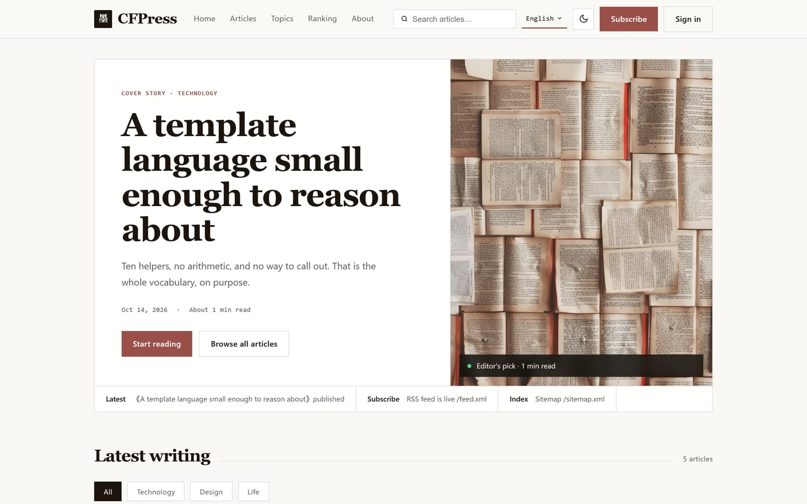
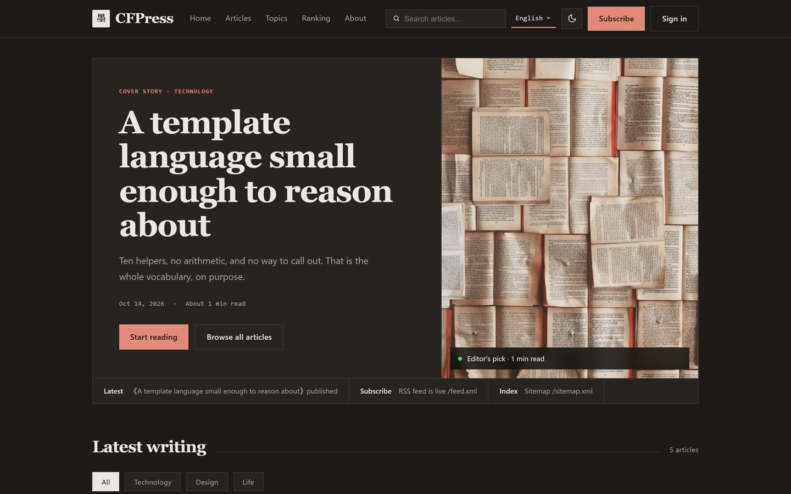
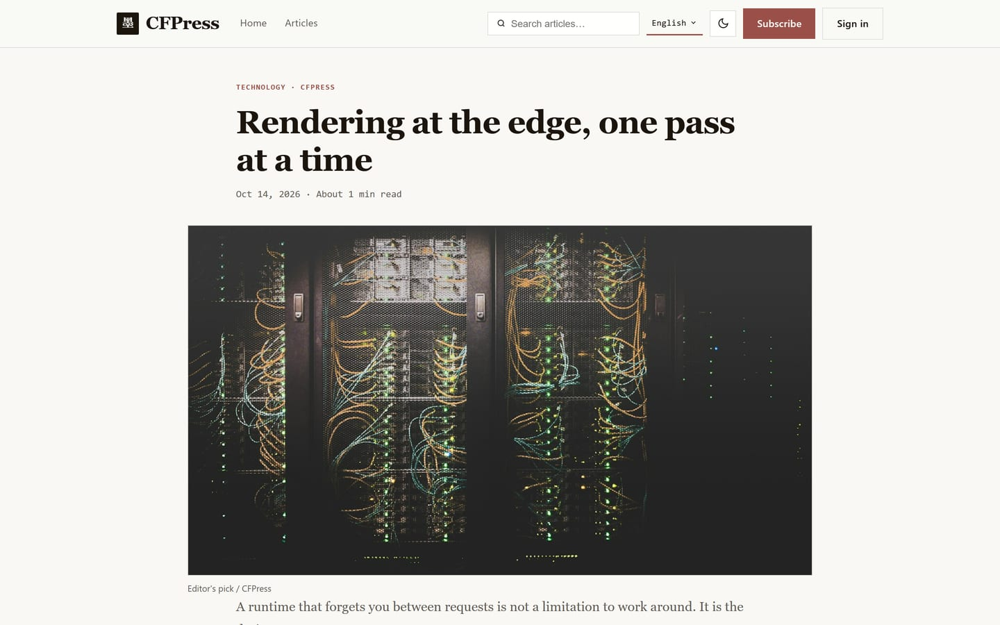
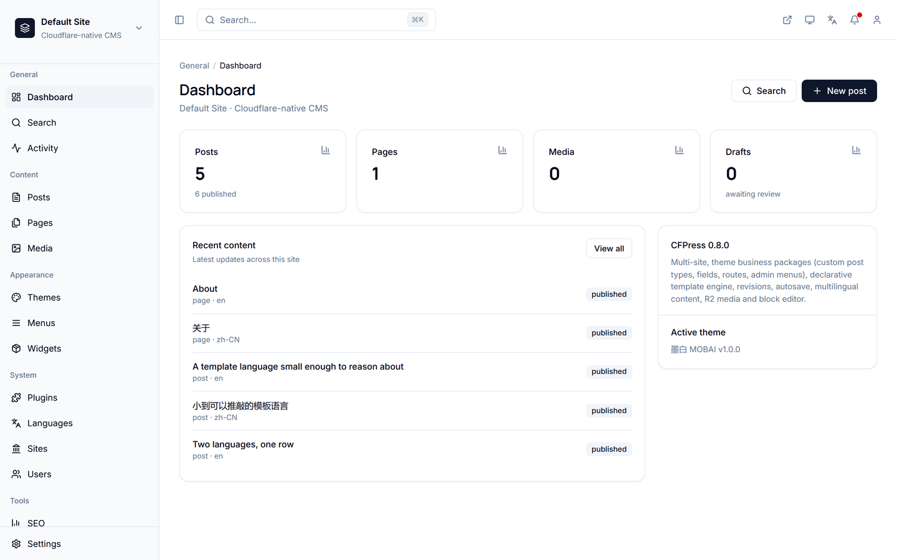
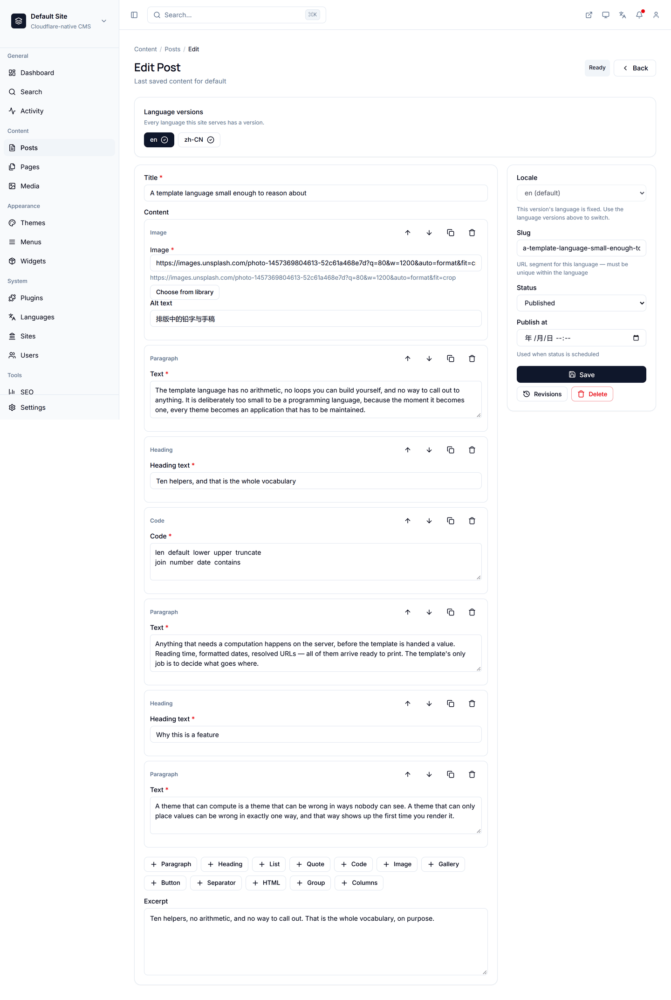
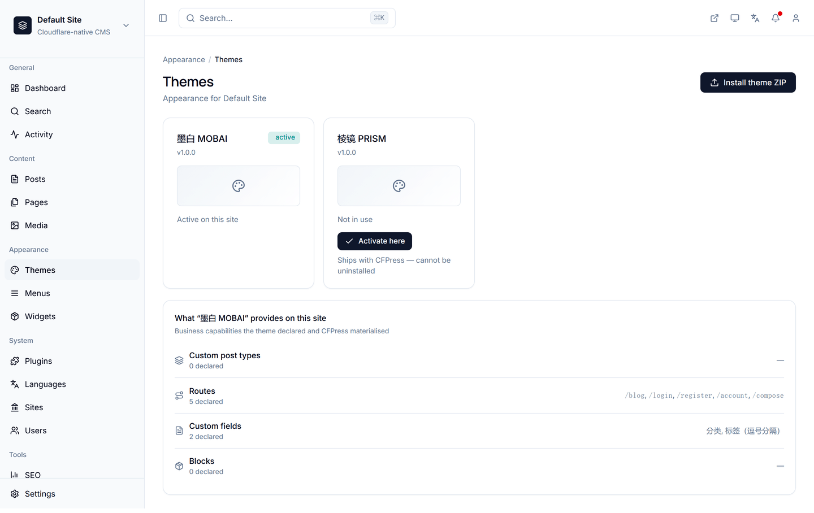
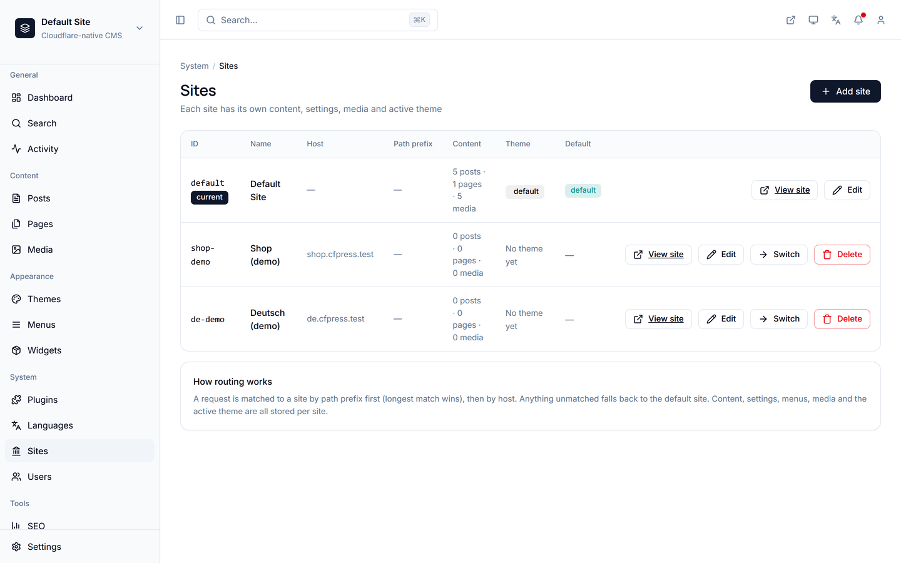
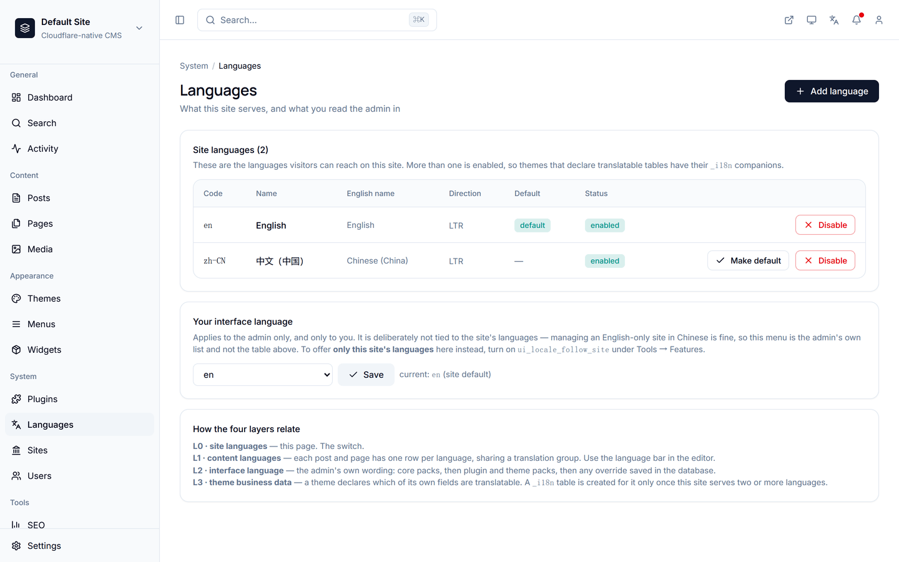

# CFPress

[English](README.md) · **简体中文**

**一个 WordPress 风格的 CMS，完整跑在 Cloudflare 边缘节点上 —— 并且永不执行第三方代码。**

[](LICENSE)
[](https://workers.cloudflare.com/)
[](tsconfig.json)
[](package.json)

**在线 Demo → [demo.cfpress.cc](https://demo.cfpress.cc)**
**→ 后台 [demo.cfpress.cc/admin](https://demo.cfpress.cc/admin)** — 演示账号：`admin` / `change-me-now`
> Demo 每小时自动还原内容。以上账号仅用于演示；真实部署必须在站点可从公网访问前修改密码。


CFPress 是一个自托管内容管理系统，构建在 Cloudflare Workers、D1、R2 和 KV 之上。
它提供你对 WordPress 的一切预期 —— 主题、插件、多站点、多语言内容、会员、媒体库、
区块编辑器 —— 但没有需要维护的服务器，也没有那套让 WordPress 站点成为长期安全靶子的扩展模型。

---

## 它长什么样

本 README 里的每张截图都是本地 `wrangler dev` 的真实抓图：应用了 24 个迁移，
两种语言各播了一份演示内容，五张图片上传到 R2，三个站点由同一个 Worker 提供服务。
这里没有任何效果图。

**深色模式不是第二套页面。** 主题只声明一次颜色（以 token 形式），
整站 —— 首页、文章页、后台相关界面 —— 全部跟随。



**文章在服务端一次渲染完成。** 代码块、引用、图片和标签都出自同一套声明式模板。
这个引擎没有能力运行任何别的东西 —— 这正是重点。



**后台是一个 Worker 里的十六个模块。** 内容、媒体、主题、插件、语言、站点、
用户、SEO、菜单、小工具、跳转、操作日志 —— 没有独立服务，仓库里没有构建步骤。



**一行数据，两种语言。** 编辑器顶部的切换器就是这篇内容的各语言版本。
每种语言有自己的 slug、自己的 URL、自己的 feed 条目 —— 而不是存在某个插件副表里的译文副本。



---

## 为什么选择 CFPress

### 第三方代码永不执行

WordPress 的插件模型允许任何插件在你的请求链路里执行任意 PHP。
这一个设计决定，就是它大部分安全记录的根源。

CFPress 做了相反的选择。**扩展是数据，不是代码。** 主题是一包声明式模板，
由一套受限的引擎渲染；插件是一份声明能力的清单。上传的扩展 ZIP 只会被存储 ——
永远不会被 Worker 执行。这里不存在任何把你的请求交给别人程序的钩子。

代价是真实的，也值得明说：声明式主题比任意 PHP 表达力更弱。
如果你需要一个插件去做清单词汇表无法表达的事，CFPress 不会让你硬塞进去。
这是有意做出的取舍。

主题也可以声明它需要的**业务能力** —— 自定义内容类型、路由、自定义字段、区块 ——
CFPress 在安装时把它们实体化。主题描述站点是什么，而不是靠运行代码把它变成那样。



### 多站点与多语言是内建的，不是外挂的

在 WordPress 里，多语言站点需要第三方插件，多站点需要网络配置。
在 CFPress 里，两者在数据库层面都是一等公民：

- **内容语言**是按语言划分的翻译行，每种语言有自己的 slug。`/en/blog/hello`
  和 `/zh-CN/blog/ni-hao` 可以是同一篇文章。
- **显式的语言前缀会 404，而不是悄悄返回另一种语言** —— 缺翻译就是缺页面，不会有意外。
- `hreflang` 替代链接、分语言的 feed 和 sitemap 由平台直接输出。
- **站点**在存储层隔离：每张表都带归属声明，每个查询都按 `site_id` 收窄，
  删除站点不会留下注册表残留。

三个站点，一个 Worker。路由先按路径前缀匹配（最长匹配优先），再按 host 匹配；
内容、设置、菜单、媒体和当前主题都按站点存储。



四层语言被刻意保持相互独立：*站点*对外提供的语言、*一篇内容*用什么语言撰写、
*后台界面*的语言、*主题业务数据*被翻译成的语言。
一个只提供英文的站点配一个中文后台，在这里是正常配置，而不是变通做法。



### 完整 CMS，跑在 Cloudflare 免费额度内

Workers + D1 + R2 + KV 都有免费额度。CFPress 就是照着在这些额度内运行来设计的：
不需要任何付费绑定，唯一需要付费计划的可选能力（为自带 Worker 的主题提供沙箱）
默认关闭，且在没有它时能干净降级。免费计划下的部署是一个**能用的 CMS，
只是拒绝那一种主题形态** —— 而不是一个坏掉的 CMS。

再往下一层也是同一个道理。R2 存放上传的媒体和上传的主题，但**省略这个绑定部署出来的站点照样能渲染**：
内置主题的模板和文案都从 worker assets 读取，所以 `MEDIA` 是可选的，
没有存储桶的安装是一个"媒体库为空"的 CMS，而不是每一页都回 `1101` 的 CMS。

真正离不开存储桶的是**存储**，而它同样是**可选的**：`media_store_r2` 开关
（工具 → 功能，**默认关闭**）决定本站是否往 R2 写入 —— 所以一个部署可以声明了存储桶
却选择不使用它，运维也可以不重新部署就打开存储。上传被拒绝时，`503` 会说明缺的是
两者中的哪一个：开关，还是绑定 —— 因为两者的修法不同，说错了只会让你绕圈子。

---

## 快速开始

```bash
git clone https://github.com/unifare/cfpress.git
cd cfpress
npm install
```

创建两个账号级资源，然后记下它们的 id：

```bash
npx wrangler d1 create cfpress
npx wrangler kv namespace create CACHE
```

把返回的 id 写进一个被 gitignore 的 **`wrangler.ids.json`**：

```json
{
  "REPLACE_WITH_D1_DATABASE_ID": "<来自 `wrangler d1 create` 的 id>",
  "REPLACE_WITH_KV_NAMESPACE_ID": "<来自 `wrangler kv namespace create` 的 id>"
}
```

启动开发服务器：

```bash
npm run dev
```

开发服务器监听 **47913**（不是 wrangler 默认的 8787 —— 8787 会和机器上其他所有 Wrangler
项目撞车，而两个 `wrangler dev` 实例抢同一个本地 D1，正是你得到毫无头绪的 `SQLITE_BUSY`
的原因）。可用 `CFP_PORT` 覆盖。

打开 `http://localhost:47913/admin/`，使用 `admin` / `change-me-now` 登录。

> **Worker 首次启动时会创建一个管理员账号——`admin`，密码 `change-me-now`，两者都是公开已知的。
> 请立刻修改密码——在站点能从公网访问之前。**
> 密码以 PBKDF2 哈希存储，明文从不落盘，但一个写在公开仓库里的默认值不是秘密。
> 会话是带签名的 Cookie，有效期 14 天。

### 部署

```bash
npm run db:migrate   # 把迁移应用到远端 D1
npm run deploy       # 生成本地配置并部署
```

迁移必须在部署**之前**跑：新代码会写新列，缺列就是 500。反过来则是无害的。

有两个命令会刻意拒绝做错事。当生成的配置里还留着 `REPLACE_WITH_...` 占位符时，
`deploy` 不会执行 —— 带着占位符部署不会大声失败，而是产出一个数据库绑定指向空处的 Worker。
而 `wrangler.local.jsonc` 是**生成**的，永远不要手改；它由提交进仓库的 `wrangler.jsonc`
加上你的 `wrangler.ids.json` 推导而来。

---

## 功能一览

| 领域 | 内容 |
|---|---|
| **内容** | 文章与页面、分类、标签、区块编辑器、修订版本、自动保存、基于 5 分钟 cron 的定时发布 |
| **媒体** | R2 支撑的媒体库、共享选择器、按站点归属收窄 |
| **多站点** | 存储层站点隔离、按站点设置、按站点用户角色 |
| **语言** | 内容语言、界面语言、分语言 slug、`hreflang`、分语言的 feed 与 sitemap |
| **会员** | 前台注册与账号体系，与后台身份相互独立 |
| **访问控制** | `admin` / `editor` / `author` 能力矩阵，在服务端强制执行 |
| **主题** | 声明式模板引擎，以 ZIP 打包、存于 R2，内置 3 个示例 |
| **插件** | 清单声明的能力、声明的设置 schema、通知渠道 |
| **搜索** | 面向已发布内容的搜索 API，外加一个后台搜索界面 |
| **缓存** | 内容缓存版本号，内容变更时自动失效 |

---

## 与其他方案对比

| | CFPress | WordPress | Ghost | Strapi |
|---|---|---|---|---|
| 运行时 | Cloudflare 边缘（Workers） | PHP + 服务器 | Node + 服务器 | Node + 服务器 |
| 需要维护的服务器 | 无 | 有 | 有 | 有 |
| 跑一个小站点的成本 | 免费额度 | VPS 或主机 | VPS 或托管套餐 | VPS 或托管套餐 |
| 第三方代码是否执行 | **从不** | 是（PHP 插件） | 是（Node） | 是（Node） |
| 多站点 | 内建 | 需网络配置 | 未内建 | 未内建 |
| 多语言内容 | 内建，分语言 slug | 插件 | 部分支持 | 插件 |
| 数据存储 | D1 (SQLite) + R2 + KV | MySQL | MySQL | Postgres/MySQL |

这不是一份同口径跑分 —— 它比较的是形态。当你想要一个没有服务器、攻击面更小的 CMS 时，
CFPress 是对的选择。当你需要 WordPress 插件生态时，它是错的选择，
因为那个生态恰恰是它拒绝运行的东西。

---

## 架构

Worker 源码是分层的，依赖只向右：

```
shared  <-  platform  <-  rendering  <-  extensions  <-  index.ts
```

| 层 | 职责 |
|---|---|
| `src/shared/` | 不含领域知识的原语：加密、缓存版本号、功能开关 |
| `src/platform/` | 领域服务：认证、站点、会员、i18n、媒体策略、后台菜单 |
| `src/rendering/` | 声明式模板引擎与区块渲染器 |
| `src/extensions/` | 主题与插件契约、清单校验、插件运行时 |
| `src/index.ts` | 请求路由与组装 |

```
content/          会被加载进运行中安装实例的内容
  themes/           内置主题（default、prism、fixture）
  plugins/          内置插件（notify）
  migrations/       有序的 D1 迁移流
public/admin/     无构建的后台 SPA，作为静态资源提供
scripts/          脚手架、部署辅助脚本、启动器（一对）
tests/            28 个套件 —— 见下
```

### 测试

```bash
npm test                    # 全部套件
sh scripts/cfpress.sh test  # 启动器，每个套件独立进程
```

这些套件是行为级和架构级的，不是单元测试：它们断言系统应当成立的不变量 ——
分层边界、租户隔离、按语言的 URL 解析、缓存失效、清单校验、后台 SPA 的契约。
其中若干套件由 `tests/tools/` 下的注入工具做**反向验证**，
因为一个从未被观察到变红的守卫，和一个根本没有守卫是无法区分的。

### 启动器

`scripts/cfpress.sh`（POSIX sh）与 `scripts/cfpress.ps1`（Windows PowerShell）
把常用命令包成一个带数字菜单的入口。如果两者出现漂移，会有一个一致性套件失败。

```bash
sh scripts/cfpress.sh            # 交互式菜单
sh scripts/cfpress.sh dev        # 启动开发服务器
sh scripts/cfpress.sh migrate:local
sh scripts/cfpress.sh test       # 每个套件独立进程
sh scripts/cfpress.sh doctor     # 环境报告
```

---

## 编写主题

一个主题就是一个目录，含 `theme.json` 清单、`templates/`，以及可选的 `langs/`：

```
content/themes/mytheme/
  theme.json
  templates/
    index.html
    single.html
    page.html
    404.html
    parts/
      layout.html
      header.html
      footer.html
  langs/
    en.json
    zh-CN.json
```

模板是声明式 HTML，配一门刻意受限的小表达式语言 ——
占位符、`@extends` / `@section` / `@include` / `@query`，以及十个助手
（`len`、`default`、`lower`、`upper`、`truncate`、`join`、`number`、`date`、`contains`）。
没有算术，没有任意代码。生成一个骨架：

```bash
npm run make:theme
```

## 编写插件

插件是一份声明它需要什么的清单。它可以拥有数据库表、贡献后台菜单、
暴露带声明 schema 的设置、通过渠道发送通知。它不能在请求链路里运行代码。
生成一个骨架：

```bash
npm run make:plugin
```

---

## 项目状态

1.0 之前。核心已完成并在运行：多站点、多语言、会员、媒体、主题、插件、定时发布、搜索。
API 在 1.0 之前仍可能变化。

本仓库分发运行时、后台界面、内置主题与插件，以及测试套件。
项目的内部设计文档 —— 架构记录、变更契约、开发交接 —— 私下维护，不在本分发之内。

---

## 许可证

CFPress 以 **GNU Affero 通用公共许可证 v3.0** 授权，并提供**商业许可证**作为替代方案。
完整 AGPL 文本见 [LICENSE](LICENSE)，何时需要商业选项见 [COMMERCIAL.md](COMMERCIAL.md)。

简言之：

- **在 AGPL-3.0 下免费**：用于运行你自己的站点、内部系统、评估、研究，
  以及任何本身即为 AGPL-3.0 的项目。
- **需要商业许可证**：如果你把 CFPress 作为托管服务提供给第三方而不公开你的修改，
  或把它嵌入闭源产品。

AGPL 相比普通 GPL 多一项义务：如果你把**修改过的**版本作为网络服务运行，
你必须向该服务的用户提供对应源码。原样运行作为你自己的站点，则除了保留声明之外
不承担此项义务。

贡献需要同意 [CLA](CLA.md) —— 这正是双许可得以成立的原因，
因为项目必须持有足够的权利，才能提供商业选项。

## 商标

CFPress 与 Cloudflare, Inc. 及 WordPress Foundation 无隶属、背书或赞助关系。
"Cloudflare" 与 "WordPress" 是各自所有者的商标，此处仅用于说明本软件运行于何处、
以及可与什么相比。
